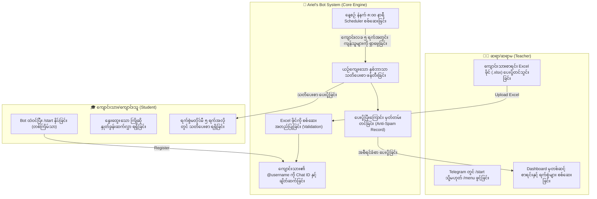
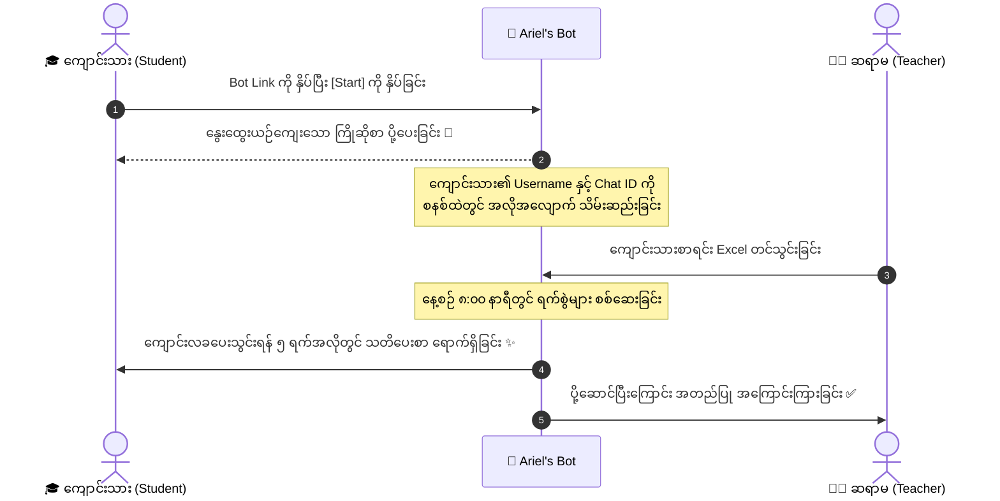

# 📖 Ariel Atlas — Ariel's English Class Payment Reminder Bot
### ဆရာ/ဆရာမများနှင့် Client များအတွက် အသုံးပြုနည်း ပြည့်စုံသော လမ်းညွှန်စာအုပ်

> **ကြိုဆိုပါသည်!** 🤍  
> ဤလမ်းညွှန်ချက်သည် **Ariel's English Class** ၏ Telegram ကျောင်းလခ သတိပေး Bot အသုံးပြုပုံ၊ အလုပ်လုပ်ပုံအဆင့်ဆင့်နှင့် စနစ်ဖွဲ့စည်းပုံတို့ကို မြန်မာဘာသာဖြင့် အလွယ်ကူဆုံး နားလည်နိုင်ရန် ရေးသားထားသော စာရွက်စာတမ်းဖြစ်ပါသည်။

---

## 📑 မာတိကာ (Table of Contents)

1. [Bot ၏ အဓိက ရည်ရွယ်ချက်နှင့် အကျဉ်းချုပ် (Overview)](#1-bot-၏-အဓိက-ရည်ရွယ်ချက်နှင့်-အကျဉ်းချုပ်-overview)
2. [စနစ်တစ်ခုလုံး အလုပ်လုပ်ပုံ (System Architecture Diagram)](#2-စနစ်တစ်ခုလုံး-အလုပ်လုပ်ပုံ-system-architecture-diagram)
3. [ဆရာ/ဆရာမများအတွက် အသုံးပြုနည်း (Teacher's Guide)](#3-ဆရာဆရာမများအတွက်-အသုံးပြုနည်း-teachers-guide)
   - [Dashboard ကို ဖွင့်လှစ်အသုံးပြုခြင်း](#၃၁-dashboard-ကို-ဖွင့်လှစ်အသုံးပြုခြင်း)
   - [Excel ဖိုင် ပြင်ဆင်ခြင်းနှင့် တင်သွင်းခြင်း (Excel Upload)](#၃၂-excel-ဖိုင်-ပြင်ဆင်ခြင်းနှင့်-တင်သွင်းခြင်း-excel-upload)
   - [ကျောင်းသားစာရင်း စစ်ဆေးခြင်း (Student Roster)](#၃၃-ကျောင်းသားစာရင်း-စစ်ဆေးခြင်း-student-roster)
   - [ချက်ချင်း သတိပေးချက်ပေးပို့ခြင်း (Instant Reminder Check)](#၃၄-ချက်ချင်း-သတိပေးချက်ပေးပို့ခြင်း-instant-reminder-check)
   - [ကျောင်းသားစာရင်းမှ ပယ်ဖျက်ခြင်း (Remove Student)](#၃၅-ကျောင်းသားစာရင်းမှ-ပယ်ဖျက်ခြင်း-remove-student)
4. [ကျောင်းသား/ကျောင်းသူများအတွက် အတွေ့အကြုံ (Student's Experience)](#4-ကျောင်းသားကျောင်းသူများအတွက်-အတွေ့အကြုံ-students-experience)
5. [အလိုအလျောက် သတိပေးစနစ် အလုပ်လုပ်ပုံ (Automated Scheduler)](#5-အလိုအလျောက်-သတိပေးစနစ်-အလုပ်လုပ်ပုံ-automated-scheduler)
6. [သတိပေးစာ ပုံစံနမူနာ (Bilingual Reminder Template)](#6-သတိပေးစာ-ပုံစံနမူနာ-bilingual-reminder-template)
7. [မကြာခဏ မေးလေ့ရှိသော မေးခွန်းများနှင့် ဖြေရှင်းချက်များ (FAQ & Troubleshooting)](#7-မကြာခဏ-မေးလေ့ရှိသော-မေးခွန်းများနှင့်-ဖြေရှင်းချက်များ-faq--troubleshooting)

---

## 1. Bot ၏ အဓိက ရည်ရွယ်ချက်နှင့် အကျဉ်းချုပ် (Overview)

Ariel's English Class Reminder Bot သည် ဆရာ/ဆရာမများ ကျောင်းလခကောက်ခံရာတွင် အချိန်ကုန်သက်သာစေရန်နှင့် အဆင်ပြေချောမွေ့စေရန် ဖန်တီးထားသော **Smart Telegram Assistant** ဖြစ်ပါသည်။

### 🌟 အဓိက အားသာချက်များ:
* **ကိုယ်ပိုင်စာရင်း သီးသန့်စီမံနိုင်ခြင်း (Multi-User Privacy):** ဆရာမ Ariel အပါအဝင် ခွင့်ပြုထားသော ဆရာ/ဆရာမတိုင်းသည် မိမိတို့၏ အတန်းနှင့် ကျောင်းသားစာရင်းကို သီးခြားစီမံနိုင်ပြီး အခြားသူများ၏ စာရင်းနှင့် ရောထွေးမှုမရှိပါ။
* **Excel မှတစ်ဆင့် လွယ်ကူစွာ စာရင်းသွင်းနိုင်ခြင်း:** ကျောင်းသားနာမည်၊ Telegram Username နှင့် ပေးသွင်းရမည့်ရက်စွဲ (Due Date) ၃ ခုသာ ထည့်သွင်းပေးရန် လိုအပ်ပါသည်။
* **ကျောင်းသားများအတွက် အလွန်ရိုးရှင်းခြင်း:** ကျောင်းသားများအနေဖြင့် Bot ထဲသို့ ဝင်ရောက်ပြီး `/start` ခလုတ် တစ်ချက်နှိပ်ထားရုံဖြင့် လုံလောက်ပါသည်။
* **အလိုအလျောက် ၅ ရက်ကြိုတင် သတိပေးခြင်း:** ကျောင်းလခပေးသွင်းရန် ၅ ရက်အလိုမှစတင်၍ နေ့စဉ် နံနက် ၈:၀၀ နာရီတွင် ယဉ်ကျေးပျူငှာသော နှစ်ဘာသာ (English + Myanmar) စာတိုကို အလိုအလျောက် ပေးပို့ပေးပါသည်။
* **ထပ်ခါထပ်ခါ စာမပို့ခြင်း (Zero Duplicate Spam):** တစ်လအတွက် သတိပေးစာ ပို့ပြီးပါက ထိုလအတွက် ထပ်မံစာမပို့ဘဲ အလိုအလျောက် မှတ်သားထားပါသည်။

---

## 2. စနစ်တစ်ခုလုံး အလုပ်လုပ်ပုံ (System Architecture Diagram)

အောက်ပါပုံသည် စနစ်တစ်ခုလုံး အစမှအဆုံး မည်သို့ အချိတ်အဆက်မိမိ အလုပ်လုပ်သည်ကို ပြသထားပါသည်။



---

## 3. ဆရာ/ဆရာမများအတွက် အသုံးပြုနည်း (Teacher's Guide)

### ၃.၁ Dashboard ကို ဖွင့်လှစ်အသုံးပြုခြင်း
Telegram တွင် Bot ဆီသို့ `/start` သို့မဟုတ် `/menu` ဟု စာပို့လိုက်ပါက အောက်ပါအတိုင်း သပ်ရပ်လှပသော **Teacher Dashboard** ပေါ်လာပါမည်။

```
✨ ARIEL'S CONTROL PANEL ✨
━━━━━━━━━━━━━━━━━━━━━
👋 Welcome back, Teacher!
🏫 Dashboard ready for your class.

📊 Class Overview:
  • Total Students: 12
  • Ready: 10 ✅
  • Waiting for Start: 2 ⚠️

⏰ Reminder Schedule:
  • Mode: Daily at 8:00 AM (Asia/Yangon)
  • Window: Within 5 days before due date
```

**အောက်တွင် ရွေးချယ်နိုင်သော ခလုတ်များ (Action Buttons):**
* `[📋 Student Roster]` — ကျောင်းသားစာရင်း၊ ရက်စွဲများနှင့် ချိတ်ဆက်မှု အခြေအနေများကို ကြည့်ရှုခြင်း။
* `[📨 Send Reminders Now]` — မနက်ဖြန်အထိ မစောင့်ဘဲ ယခုချက်ချင်း သတိပေးစာ ပေးပို့ရန် စစ်ဆေးခြင်း။
* `[🗑️ Remove Student]` — မလိုလားအပ်သော ကျောင်းသားကို စာရင်းမှ လွယ်ကူစွာ ပယ်ဖျက်ခြင်း။
* `[📖 How to Use]` — အသုံးပြုနည်း အကျဉ်းချုပ် လမ်းညွှန်ဖတ်ရှုခြင်း။
* `[🔄 Refresh Dashboard]` — ကိန်းဂဏန်းအသစ်များကို ပြန်လည် Refresh လုပ်ခြင်း။

---

### ၃.၂ Google Sheet Link ချိတ်ဆက်ခြင်းနှင့် Excel ဖိုင် တင်သွင်းခြင်း

ဆရာ/ဆရာမများအနေဖြင့် **Google Sheet Link** ကို Bot ထံသို့ တိုက်ရိုက်ပေးပို့၍ အလွယ်တကူ ချိတ်ဆက်နိုင်ပါသည် (သို့မဟုတ် Excel `.xlsx` ဖိုင်ကိုလည်း ပေးပို့နိုင်ပါသည်)။

#### 🔗 Google Sheet Link ဖြင့် အသုံးပြုပုံ (အလွယ်ကူဆုံးနည်းလမ်း):
1. **Google Sheet တွင် စာရင်းပြုစုပါ:** အောက်ပါကော်လံ (၃) ခုဖြင့် ဖြည့်သွင်းပါ။
2. **Share ခွင့်ပြုချက်ဖွင့်ပါ:** Google Sheet ၏ ညာဘက်အပေါ်ရှိ **Share** ခလုတ်ကို နှိပ်ပြီး General access တွင် **"Anyone with the link"** (Viewer) သို့ ပြောင်းပါ။
3. **Link ကို Bot ထံ ပေးပို့ပါ:** Sheet Link ကို Copy ယူ၍ Bot ထဲသို့ Paste လုပ်ပြီး စာပို့လိုက်ပါ (သို့မဟုတ် `/sheet <link>`)။
4. **တစ်သက်တာ ချိတ်ဆက်ပြီးဖြစ်ပါသည်:** စာရင်းအသစ်တိုးတိုင်း သို့မဟုတ် ရက်စွဲပြင်တိုင်း Dashboard ရှိ **`[🔄 Sync Google Sheet]`** ခလုတ်ကို နှိပ်လိုက်ရုံဖြင့် အလိုအလျောက် Update ဖြစ်သွားပါမည်။ နေ့စဉ် နံနက် ၈:၀၀ နာရီ သတိပေးချက်များ စစ်ဆေးရာတွင်လည်း Bot က Google Sheet မှ အသစ်ဆုံးစာရင်းကို အလိုအလျောက် ဆွဲယူစစ်ဆေးပေးပါမည်။

#### 📋 စာရင်းဇယားတွင် ထည့်သွင်းရမည့် ကော်လံ (၃) ခု:

| student_name | telegram_username | due_date |
| :--- | :--- | :--- |
| Ma Su Su | @susu_eng | 2026-10-25 |
| Mg Mg | @mgmg_class | 2026-10-27 |
| Ko Tun | @tun_student | 2026-11-02 |

> [!IMPORTANT]
> **အရေးကြီးသော အချက်များ:**
> 1. **`telegram_username`** တွင် `@` သင်္ကေတ အမြဲပါဝင်ရပါမည် (ဥပမာ - `@susu_eng`)။
> 2. **`due_date`** ၏ ပုံစံသည် `YYYY-MM-DD` (နှစ်-လ-ရက်) ဖြစ်ရပါမည် (ဥပမာ - `2026-10-25`)။
> 3. ကျောင်းသားများ၏ **Chat ID (ဂဏန်းကုဒ်)** ထည့်သွင်းပေးရန် **လုံးဝမလိုပါ**။ Bot က ကျောင်းသား၏ Username ဖြင့် အလိုအလျောက် ရှာဖွေချိတ်ဆက်ပေးပါမည်။

#### 📤 ဖိုင်ပေးပို့ပြီးချိန်တွင် ပြသမည့် Card:
ဖိုင်ကို Bot ထံ ပေးပို့လိုက်သည်နှင့် ချက်ချင်း စစ်ဆေးပြီး အောက်ပါအတိုင်း အတည်ပြုကတ် ပေါ်လာပါမည်-
```
📁 Excel Roster Loaded
━━━━━━━━━━━━━━━━━━━━━
👥 Total Students: 12
✅ Linked & Ready: 10
⚠️ Waiting to Tap Start: 2
```

---

### ၃.၃ ကျောင်းသားစာရင်း စစ်ဆေးခြင်း (Student Roster)
`[📋 Student Roster]` ခလုတ်ကို နှိပ်ပါက ကျောင်းသားတစ်ဦးချင်းစီ၏ အချက်အလက်များကို ရှင်းလင်းစွာ တွေ့မြင်နိုင်ပါသည်:

* 👤 **Ma Su Su** (`@susu_eng`)  
  └ 📅 Due: `2026-10-25` (in 3 days) • Status: Linked ✅
* 👤 **Mg Mg** (`@mgmg_class`)  
  └ 📅 Due: `2026-10-27` (in 5 days) • Status: Linked ✅
* 👤 **Ko Tun** (`@tun_student`)  
  └ 📅 Due: `2026-11-02` (in 11 days) • Status: Waiting to tap /start ⚠️

---

### ၃.၄ ချက်ချင်း သတိပေးချက်ပေးပို့ခြင်း (Instant Reminder Check)
မနက် ၈:၀၀ နာရီအထိ မစောင့်ဘဲ မိမိစိတ်ကြိုက်အချိန်တွင် သတိပေးစာ ပေးပို့လိုပါက `[📨 Send Reminders Now]` ခလုတ်ကို နှိပ်နိုင်ပါသည်။  
Bot မှ ၅ ရက်အတွင်း ကျောင်းလခပေးသွင်းရန် ကျန်ရှိသော ကျောင်းသားများကို စစ်ဆေး၍ စာပို့ပေးပြီး မည်သူ့ထံ ပို့ဆောင်ပြီးကြောင်း အစီရင်ခံစာ ချက်ချင်း ပြသပေးပါမည်။

---

### ၃.၅ ကျောင်းသားစာရင်းမှ ပယ်ဖျက်ခြင်း (Remove Student)
သင်တန်းပြီးဆုံးသွားသော သို့မဟုတ် နားသွားသော ကျောင်းသားများကို ပယ်ဖျက်လိုပါက:
1. `[🗑️ Remove Student]` ခလုတ်ကို နှိပ်ပါ။
2. ပယ်ဖျက်လိုသော ကျောင်းသားအမည်ကို ရွေးချယ်ပါ။
3. အမှားအယွင်းမဖြစ်စေရန် "သေချာပါသလား" ဟု အတည်ပြုခလုတ်ပေါ်လာပါမည်။
4. `[✅ Yes, Remove]` ကို နှိပ်လိုက်ပါက စာရင်းမှ အပြီးတိုင် ဖယ်ရှားပေးပါမည်။

---

## 4. ကျောင်းသား/ကျောင်းသူများအတွက် အတွေ့အကြုံ (Student's Experience)

ကျောင်းသားများအတွက် အသုံးပြုရသည်မှာ အလွန်လွယ်ကူပြီး မည်သည့်နည်းပညာ အသိပညာမျှ မလိုအပ်ပါ။

### 🚶‍♂️ ကျောင်းသားလုပ်ဆောင်ရမည့် အဆင့် (၃) ဆင့်:



#### 💌 ကျောင်းသား ပထမဆုံး `/start` နှိပ်ချိန်တွင် မြင်တွေ့ရမည့် မက်ဆေ့ခ်ျ:
> 👋 **Hello, Ma Su Su!**  
> Welcome to **Ariel's English Class**! 🤍  
> 
> ✅ **You're all set!**  
> You will receive a gentle reminder here whenever your monthly tuition fee is coming up.  
> 
> No further action is needed from you. Have a wonderful day! ✨

*(ကျောင်းသားထံသို့ နည်းပညာဆန်သော စာများ၊ ခလုတ်များ သို့မဟုတ် ဆရာမအသုံးပြုသော Dashboard များ လုံးဝမပြသဘဲ အေးချမ်းသပ်ရပ်စွာသာ ပေါ်မည်ဖြစ်ပါသည်။)*

---

## 5. အလိုအလျောက် သတိပေးစနစ် အလုပ်လုပ်ပုံ (Automated Scheduler)

* ⏰ **စစ်ဆေးသည့် အချိန်:** နေ့စဉ် **နံနက် ၈:၀၀ နာရီတိတိ** (မြန်မာစံတော်ချိန် `Asia/Yangon`).
* 🎯 **သတိပေးသည့် ကာလ (Window):** သတ်မှတ်ရက် မတိုင်မီ **၅ ရက်အလိုမှစတင်၍** သတ်မှတ်ရက်နေ့အထိ (Days: 5, 4, 3, 2, 1, 0)။
* 🛡️ **ထပ်ခါထပ်ခါ စာမပို့ခြင်း (Anti-Duplicate Guarantee):**
  - Bot သည် ကျောင်းသားတစ်ဦး၏ သတ်မှတ်ရက်အတွက် သတိပေးစာ ပို့ဆောင်ပြီးပါက ၎င်းမှတ်တမ်းကို စနစ်ထဲတွင် အခိုင်အမာ သိမ်းဆည်းထားပါသည်။
  - ထို့ကြောင့် ကျောင်းသားထံသို့ စိတ်အနှောင့်အယှက်ဖြစ်စေမည့် ထပ်ခါထပ်ခါ စာပို့ခြင်း (Spamming) လုံးဝမဖြစ်ပေါ်နိုင်ပါ။
* 🔔 **ဆရာမထံ အကြောင်းကြားချက်:**
  - မနက် ၈:၀၀ နာရီတွင် ကျောင်းသားထံ သတိပေးစာ ပို့ပြီးတိုင်း ဆရာမထံသို့လည်း မည်သည့်ကျောင်းသားထံ ပေးပို့ခဲ့သည်ကို အောက်ပါအတိုင်း အလိုအလျောက် အသိပေးစာ ရောက်ရှိလာပါမည်:
  ```
  ⏰ Automated Reminder Sent (1):
  • Ma Su Su
  ```

---

## 6. သတိပေးစာ ပုံစံနမူနာ (Bilingual Reminder Template)

ကျောင်းလခပေးသွင်းရန် ၅ ရက်အလိုတွင် ကျောင်းသားထံသို့ အောက်ပါအတိုင်း ယဉ်ကျေးပျူငှာသော နှစ်ဘာသာ စာတို ရောက်ရှိသွားမည်ဖြစ်ပါသည်:

```text
🤍 Ariel's English Class — Tuition Fee Reminder

Dear Ma Su Su,
This is a gentle reminder that the monthly fee for your class is coming up on October 25th.
Thank you for learning with us! ✨

မင်္ဂလာပါ Ma Su Su ရှင့် 🤍
Ariel's English Class အတွက် လစဥ်ကြေးပေးသွင်းရမည့်ရက်သည် October 25th ဖြစ်ပါသဖြင့် ကြိုတင်အသိပေးအပ်ပါသည်ရှင့်။
ကျေးဇူးတင်ရှိပါသည်ရှင့် ✨
```

---

## 7. မကြာခဏ မေးလေ့ရှိသော မေးခွန်းများနှင့် ဖြေရှင်းချက်များ (FAQ & Troubleshooting)

### မေးခွန်း ၁ - "Waiting to Tap Start" ဟု အဝါရောင် အချက်ပြနေရခြင်း အကြောင်းရင်းမှာ အဘယ်နည်း။
* **အဖြေ:** အဆိုပါ ကျောင်းသားသည် Bot ထဲသို့ ဝင်ရောက်၍ `/start` ခလုတ်ကို မနှိပ်ရသေးသောကြောင့် ဖြစ်ပါသည်။ Telegram ၏ လုံခြုံရေးစည်းမျဉ်းအရ အသုံးပြုသူတစ်ဦးက Bot ကို ဦးစွာ `/start` မနှိပ်ပါက Bot ဘက်မှ စတင်စာပို့ခွင့် မရှိပါ။
* **ဖြေရှင်းနည်း:** ကျောင်းသားထံသို့ Bot Link (ဥပမာ - `t.me/your_bot_username`) ပေးပို့ပြီး **"Start"** ခလုတ်တစ်ချက် နှိပ်ပေးရန် ပြောကြားရုံသာ ဖြစ်ပါသည်။ နှိပ်ပြီးသည်နှင့် Status သည် အလိုအလျောက် `Linked ✅` သို့ ပြောင်းလဲသွားပါမည်။

### မေးခွန်း ၂ - Excel ဖိုင် တင်သွင်းရာတွင် အမှားပြနေပါက မည်သို့လုပ်ဆောင်ရမည်နည်း။
* **အဖြေ:** အောက်ပါ (၃) ချက်ကို စစ်ဆေးပါ:
  1. Excel ဖိုင်၏ ပထမဆုံးအကွက် (Headers) များသည် `student_name`, `telegram_username`, `due_date` မှန်ကန်စွာ ရေးထားခြင်း ရှိ/မရှိ။
  2. Username အရှေ့တွင် `@` သင်္ကေတ ပါရှိခြင်း ရှိ/မရှိ (ဥပမာ `@name`)။
  3. ရက်စွဲပုံစံသည် `2026-10-25` ကဲ့သို့ `YYYY-MM-DD` ပုံစံ မှန်ကန်စွာ ရေးထားခြင်း ရှိ/မရှိ။

### မေးခွန်း ၃ - သတိပေးချက် ပို့ဆောင်သည့်အချိန်ကို မနက် ၈:၀၀ အစား အခြားအချိန်သို့ ပြောင်းလဲနိုင်ပါသလား။
* **အဖြေ:** ပြောင်းလဲနိုင်ပါသည်။ အခြေခံအားဖြင့် နံနက် ၈:၀၀ နာရီဟု သတ်မှတ်ထားသော်လည်း လိုအပ်ပါက ဆာဗာ setting တွင် မိမိနှစ်သက်ရာ အချိန်သို့ အလွယ်တကူ ပြောင်းလဲပေးနိုင်ပါသည်။

---

*လမ်းညွှန်ချက် အထောက်အကူပြုမှု အပြည့်အဝရရှိစေရန် ရေးသားပြုစုထားပါသည်။*  
**Ariel's English Class • Smart Reminder Bot** ✨
